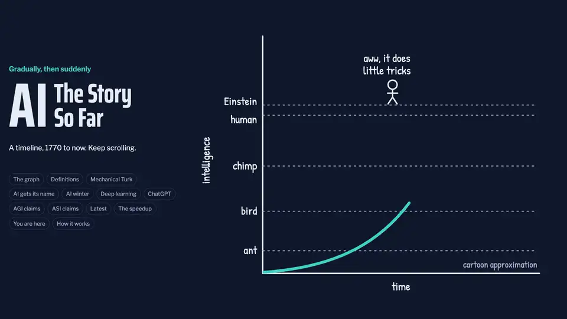

# ai-so-far

[](demo.mp4)

A scroll through the general history of AI, from the Mechanical Turk (1770) to today.

It opens on a cartoon of an exponential ("Gradually, then suddenly"), then bends that curve into a real one: the most compute ever used to train an AI model, with the milestones of AI history (ideas, machines, culture, work, science and society) laid over it. Along the way it marks when people started saying **AI**, **AGI** and **ASI**.

## Run

It's a single static page with no build step:

```sh
open index.html
```

It needs a network connection to load [D3](https://d3js.org) 7.8.5 from cdnjs and fonts from Google Fonts. The page doesn't work without D3; fonts fall back.

Deep links: `#viz` (plays the opening transition), `#def`, `#foom` (plays the brackets), `#here` and `#how` (the footnote on how the graph works). Milestones: `#turk`, `#ai`, `#winter`, `#deep`, `#chatgpt`, `#agi`, `#asi` and `#new` (always the newest). Named ones are set by title in `SLUG`; the rest are `#e1`, `#e2` and so on by position, so those shift when you add events.

## Deploy

On Netlify, import the repo and accept the defaults: `netlify.toml` publishes the repo root with no build. From the command line:

```sh
npx netlify-cli deploy --prod
```

## Edit

Everything is in `index.html`.

| What | Where |
| --- | --- |
| Colors and fonts | `:root` tokens at the top of `<style>` |
| Milestones | `const E` |
| Definitions of AI, AGI and ASI | `const G` |
| Model dots | `const MODELS` |
| Camera per milestone | `cam()` |

A milestone is an array, in date order:

```js
[date, title, text, sourceUrl, category, caution, marker, extraUrl1, extraUrl2]
```

- `date` is `YYYY`, `YYYY.MM` or `YYYY.MM.DD`.
- `caution` is an optional note for contested results.
- `marker` is `"AI"`, `"AGI"`, `"ASI"` or `null`. It makes the oversized card and the line on the chart.
- The two extra links are only shown on the Riemann card, where they are labelled as the Meta and Musk reactions.

Some things are written by hand and won't update themselves: the "1,373 days. Then 78." frame, the counts in the chart's `aria-label` and intro card, the start year, the compile date, the titles in `SLUG`, and the list of tags at the top of the page.

## Reading the chart

- The y-axis is training compute in FLOP, on a log scale. It measures resources, not intelligence.
- The line is the largest training run so far. The faint dots are individual models.
- Milestones sit on the line at their date, so their height is the compute record of the day. Those before 1950 sit on the floor, because the dataset starts there.
- The milestones are hand-picked.
- The AI, AGI and ASI lines mark when people used each word as a claim. They don't show that AGI or ASI was reached. In the widest views one to-scale band covers all three. AI sits on ChatGPT, the loudest "AI is here" moment, not on the 1956 naming.
- The opening cartoon isn't data.

## Sources and credits

- Model data: [Epoch AI](https://epoch.ai/data/ai-models), [CC BY 4.0](https://creativecommons.org/licenses/by/4.0/), downloaded 2026-11-23. 546 notable models with a date and a compute estimate; some estimates are speculative.
- The cartoon is redrawn after Tim Urban's ["The AI Revolution"](https://waitbutwhy.com/2015/01/artificial-intelligence-revolution-1.html), Wait But Why, 2015.
- Each milestone card links to its source. Many older entries were written from general knowledge and their links haven't all been checked.
- Built with Claude, which is made by Anthropic. Several 2026 entries involve Anthropic or its competitors.
